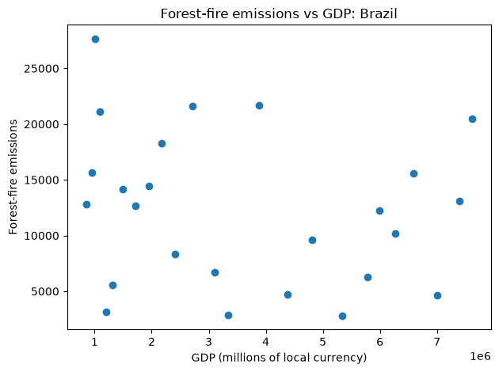
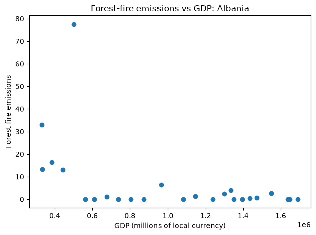
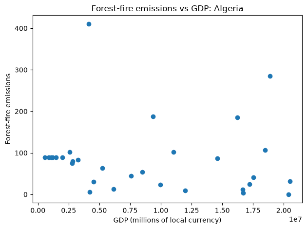

# tdd

# Forest-Fire Emissions and GDP

## Introduction

For this project, I wanted to see if there was a relationship between a country's GDP and its forest-fire emissions. My hypothesis was that forest-fire emissions would increase as GDP increased because economic growth can lead to more industrial activity, land development, and other changes that affect the environment. I wanted to see if this pattern appeared in different countries or if the relationship varied.

I looked at all countries with both information in both datasets using forest-fire emissions data from the Agrofood CO2 Emission dataset and GDP data from the IMF GDP dataset. 

## Methods

I used Python to read the two CSV files and match forest-fire emissions with GDP for the same country and year. I wrote functions to read the data, find the correct columns, and filter the rows for each country. I also made sure to skip years where emissions or GDP data were missing or where the year was not available in both datasets.

After matching the data, I created a scatter plot for each country using Matplotlib and a Snakefile. GDP is on the x-axis, and forest-fire emissions are on the y-axis. I used `src/scatter.py` to generate the plots for all countries, extending analysis from the intial TDD assignment.

## Results

Overall, I did not find a clear relationship between GDP and forest-fire emissions across the countries. My original hypothesis was that emissions would increase as GDP increased, but the plots did not show a consistent upward trend.

### Sample Plots



Brazil had a pretty sporadic pattern, and there was no obvious relationship between GDP and forest-fire emissions. Emissions varied across different GDP values, so GDP alone did not seem to explain the changes in forest-fire emissions. While all the plots look different, this plot is indicative of the general trend I saw where there was not an across the board trend. 

Other plot examples:




### What I found overall

Based on these plots, my hypothesis was not consistently supported. Brazil showed a sporadic pattern, Canada had no clear trend, and Australia had a mix of patterns. This suggests that the relationship between GDP and forest-fire emissions may be more complicated than I originally expected.

## Reproducing the Analysis


Download the datasets into the `data/` directory:

```bash
mkdir -p data
curl -L "[https://docs.google.com/uc?export=download&id=1AsXP_OGs1O_TDeXiZjk3fYV1SrG4vwXF](https://docs.google.com/uc?export=download&id=1AsXP_OGs1O_TDeXiZjk3fYV1SrG4vwXF)" -o data/Agrofood_co2_emission.csv
curl -L "[https://docs.google.com/uc?export=download&id=19YEPysdnK7VCXuAe9Og9pwYkNT5CbQzr](https://docs.google.com/uc?export=download&id=19YEPysdnK7VCXuAe9Og9pwYkNT5CbQzr)" -o data/IMF_GDP.csv
```
Run the automated Snakemake pipeline from the repository's root directory to dynamically compute valid country intersections, generate all country scatter plots, and compile the summary ranking file:
Generate the plots from the repository's root directory:

```bash
snakemake -c1
```

Run the tests:

```bash
python test/unit/test_fire_gdp.py
bash test/func/test_fire_gdp.sh
```
## To test the snakemake Workflow

1. Visualize the dependency graph
snakemake --dag | dot -Tpng > dag.png
- Use this command to visualize the dependency, so that you can visually confirm that the workflow makes sense.

2. Evaluate the steps that in theory should run:
snakemake --dryrun --printshellcmds
- This should be used so that users can see what steps would run based on the Snakefile

3. Implement testing integration when Snakefile is run
- This would make it so that everytime you run the workflow, useful things are tested regatding the snakemake.
- For instance: the desired number of shell commands exist
